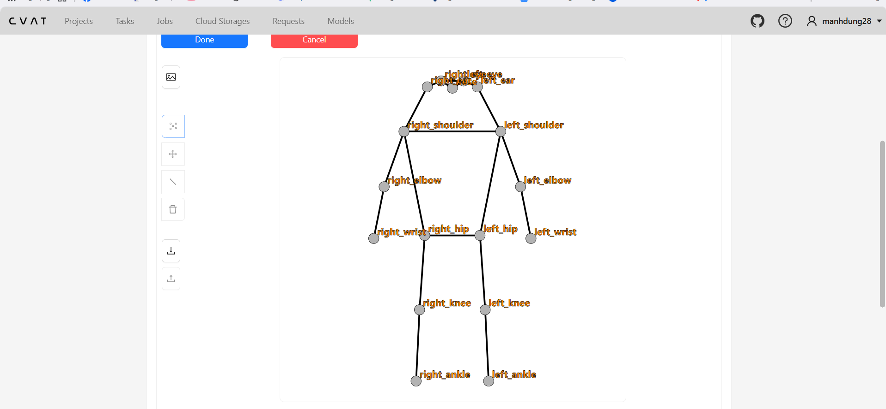
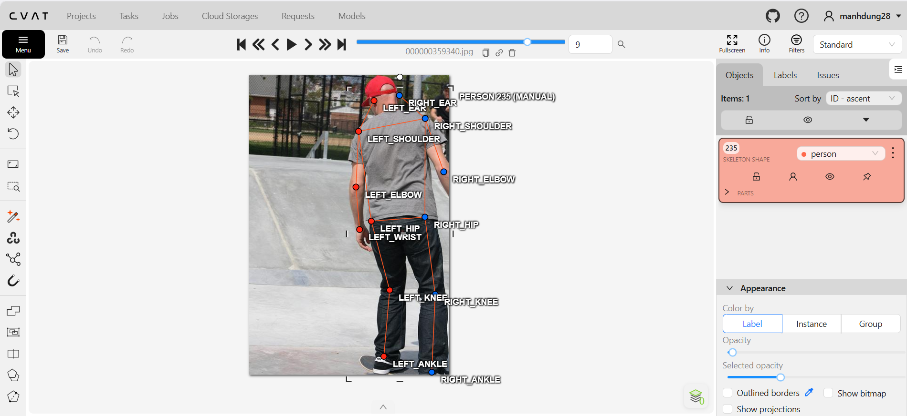
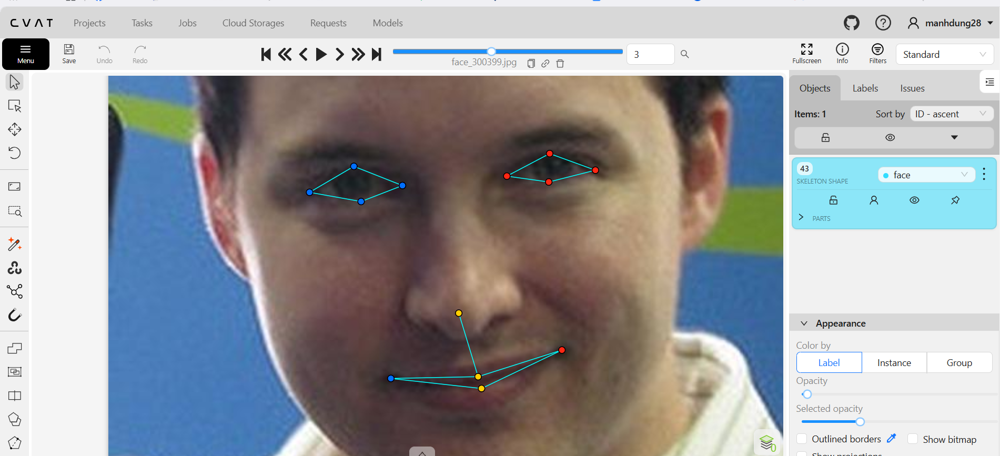
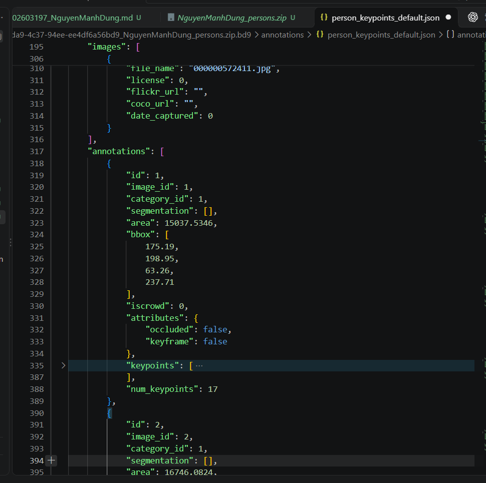

# Báo cáo cá nhân — HoVaTen-MSSV

Đổi tên file theo quy tắc `MSSV_HoTen.md`. Ví dụ: `20241234_NguyenVanAn.md`.

Dữ liệu: 12 ảnh người COCO val2017 (Lin et al., 2014) và 8 ảnh chân dung Wikimedia Commons, chỉ dùng trong lớp.

## 0. Thông tin học viên

- Họ tên: Nguyễn Mạnh Dũng
- MSSV: 2A202603197
- Email: dung28092k3@gmail.com
- Link repository: https://github.com/ngmanhdunggg/K5-L2-DAY04-NguyenManhDung-2A202603197-KeypointPose
- Phiên bản CVAT (Help → About): 2.82.0
- Máy: hệ điều hành Windows · RAM 16 GB · chạy CVAT chế độ đầy đủ
- Bộ ảnh (`src/exports/assignment.json` do `lab.py setup` tạo): có
- Giờ bắt đầu: 16:40
- Giờ kết thúc: 18:30

## 1. Kiểm tra label (CP0)

| Label | Kiểu | Số điểm | Tên điểm đúng bảng của lab? | Đúng thứ tự? | Số cạnh |
|---|---|---:|---|---|---:|
| `person` | Skeleton | 17 | Có | Có | 19 |
| `face` | Skeleton | 13 | Có | Có | 13 |

Mẫu `person` dựng theo người quay mặt về camera (các điểm `left_*` nằm bên phải khung mẫu)? Có 

Cách đổi cờ `occluded` / `outside` cho **một điểm** trên phiên bản CVAT này (một câu):

Di chuột vào điểm cần đổi cho điểm sáng lên, nhấn `Q` để bật/tắt `occluded` (`v=1`) hoặc `O` để bật/tắt `outside` (`v=0`).

## 2. Số lượng đã gán và thời gian (CP1, CP2)

| Nhóm ảnh | Số ảnh | Số skeleton đã gán | Số người dưới 60 px (không gán) | Số poster / gương / màn hình bỏ qua | Thời gian (phút) |
|---|---:|---:|---:|---:|---:|
| `easy` | 5 | 5 | 0 | 0 | Kh?ng ghi ri?ng |
| `occluded` | 3 | 6 | 0 | 0 | Kh?ng ghi ri?ng |
| `back` | 2 | 3 | 0 | 0 | Kh?ng ghi ri?ng |
| `small` | 1 | 3 | 4 | 0 | Kh?ng ghi ri?ng |
| `crowd` | 1 | 3 | 0 | 0 | Kh?ng ghi ri?ng |
| `faces` | 8 | 8 |  |  | 30 |

- Số ảnh người đã xong ở mốc phút 105: 12 / 12
- Thời gian thực tế (phút): CP1 40 · CP2 30 · CP3 20
- Ảnh tốn thời gian nhất là ảnh nào, vì sao?
Ảnh 000000189365.jpg tốn thời gian nhất vì hai người chồng lên nhau, người phía sau bị che nhiều và một số bộ phận nằm ngoài khung ảnh. Tôi mất nhiều thời gian để phân biệt các khớp của từng người, xác định trái/phải và chọn cờ visibility phù hợp cho từng điểm.

## 3. Bảng ca khó (CP1, CP2)

Mỗi điểm bạn phân vân một dòng, nhất là phân vân giữa `v = 1` và `v = 0`, hoặc không chắc hướng người.

| Ảnh | Người / mặt | Điểm | Cờ đã chọn | Phân vân giữa | Lý do chọn |
|---|---|---|---:|---|---|
| 000000381889.jpg | Người phụ nữ mặc váy ở giữa | right_knee | 1 | v=1 / v=0 | Đầu gối phải bị váy che; tôi dựa vào dáng đứng và hướng đùi để ước lượng vị trí nên chọn v=1. |
| 000000572411.jpg | Những người ngồi trên tàu | Các khớp bị che, không xác định được vị trí | 0 | v=1 / v=0 | Ảnh mờ và thân tàu che khuất các khớp; tôi không xác định chắc vị trí nên chọn v=0. |
| face_99874.jpg | Người đeo kính râm | right_eye_inner | 1 | v=1 / v=0 | Tôi dựa vào phía trong gọng kính, gần sống mũi, để ước lượng vị trí khóe trong mắt phải nên chọn v=1. |

## 4. Bảng tự review (CP3)

Đi từ ảnh cuối về ảnh đầu. 5 ảnh người (ít nhất 2 ảnh `back` hoặc `crowd`) và 3 ảnh mặt. Ít nhất 8 dòng, kể cả dòng `ok`. Ghi lỗi trước, sửa sau.

Mã lỗi dùng đúng một trong: `lr_swap`, `vis_flag`, `position`, `missing`, `extra`, `ok`.

| Ảnh | Người / mặt | Điểm | Mã lỗi | Ghi chú | Đã sửa? |
|---|---|---|---|---|---|
| Ảnh | Người / mặt | Điểm | Mã lỗi | Ghi chú | Đã sửa? |
|---|---|---|---|---|---|
| 000000381889.jpg | Người phụ nữ mặc váy ở giữa | right_knee | vis_flag | Đầu gối phải bị váy che, tôi đã đổi từ v=2 sang v=1 vì vẫn ước lượng được vị trí. | Có |
| face_99874.jpg | Người đeo kính râm | 8 điểm mắt | vis_flag | Tôi đã đổi 8 điểm mắt bị kính râm che từ v=0 sang occluded (v=1). | Có |

| 000000572411.jpg | Những người ngồi trên tàu | Toàn bộ skeleton | ok | Đã kiểm tra vị trí điểm, trái/phải và cờ visibility. | Không cần sửa |
| 000000359340.jpg | Người quay lưng đội mũ đỏ | Toàn bộ skeleton | ok | Đã kiểm tra trái/phải và cờ các điểm bị khuất. | Không cần sửa |
| 000000189365.jpg | Hai người trong ảnh | Toàn bộ skeleton | ok | Đã kiểm tra các khớp thuộc từng người và cờ các điểm bị che. | Không cần sửa |
| 000000163118.jpg | Hai người đang bật nhảy | Toàn bộ skeleton | ok | Đã kiểm tra trái/phải và tư thế chân bắt chéo. | Không cần sửa |
| face_490361.jpg | Khuôn mặt trong ảnh | Toàn bộ 13 điểm | ok | Đã kiểm tra vị trí điểm, trái/phải và cờ visibility. | Không cần sửa |
| face_469647.jpg | Khuôn mặt trong ảnh | Toàn bộ 13 điểm | ok | Đã kiểm tra vị trí điểm, trái/phải và cờ visibility. | Không cần sửa |

Tổng hợp số lỗi theo mã:

| `lr_swap` | `vis_flag` | `position` | `missing` | `extra` | `ok` |
|---:|---:|---:|---:|---:|---:|
| 0 | 2 | 0 | 0 | 0 | 6 |

Điểm còn phân vân giữa `v = 1` và `v = 0` (ghi cả hai lựa chọn và lý do chọn):

Ở ảnh face_99874.jpg, tôi phân vân giữa v=1 và v=0 cho điểm right_eye_inner vì kính râm che mắt. Tôi chọn v=1 vì có thể dựa vào phía trong gọng kính, gần sống mũi, để ước lượng vị trí khóe trong mắt phải.

## 5. Kiểm file xuất và kết quả tự kiểm (CP4)

Tự kiểm tay trong file JSON:

| File | Người / mặt kiểm (ảnh, thứ tự) | Số phần tử `keypoints` | Điểm `outside` ra `v = 0`, `occluded` ra `v = 1`? | `num_keypoints` khớp? |
|---|---|---:|---|---|
| `NguyenManhDung_persons.zip` | 000000381889.jpg, người thứ 1 trong JSON (id=15) | 51 | Có, có cả v=0 và v=1 | Có, 14 điểm v>0 |
| `NguyenManhDung_persons.zip` | 000000189365.jpg, người thứ 1 trong JSON (id=7) | 51 | Có, có cả v=0 và v=1 | Có, 13 điểm v>0 |
| `NguyenManhDung_faces.zip` | face_99874.jpg, mặt thứ 1 (id=8) | 39 | Có 8 điểm v=1, mặt này không có điểm outside | Có, 13 điểm v>0 |

Sau khi xuất, CVAT ghi `occluded` thành `v = 1` và `outside` thành `v = 0`. Tọa độ của điểm `outside` trong file là `0, 0` hay tọa độ cũ? Cũ

Hai job đã chuyển sang completed trên CVAT? Có

Dán phần **TÓM TẮT** in ra từ `src/check_submission.py`:

----- TÓM TẮT (dán vào báo cáo mục 5) -----
- File person: NguyenManhDung_persons.zip
  Số ảnh: 12 · số skeleton `person`: 20 · mỗi annotation 51 số
  Skeleton theo ảnh: 000000057978=1, 000000156986=2, 000000163118=2, 000000164659=1, 000000189365=2, 000000201702=1, 000000205650=1, 000000302102=2, 000000308257=1, 000000359340=1, 000000381889=3, 000000572411=3
  Cờ v: v=2 262 (77%) · v=1 19 (6%) · v=0 59 (17%)
  num_keypoints trung bình: 14.1
- File face: NguyenManhDung_faces.zip
  Số ảnh: 8 · số skeleton `face`: 8 · mỗi annotation 39 số
  Skeleton theo ảnh: face_125051=1, face_168953=1, face_185015=1, face_300399=1, face_356144=1, face_469647=1, face_490361=1, face_99874=1
  Cờ v: v=2 96 (92%) · v=1 8 (8%) · v=0 0 (0%)
  num_keypoints trung bình: 13.0
- Ghi chú: 59 điểm v = 0 vẫn mang tọa độ cũ (CVAT 2.x xuất như vậy; chuẩn COCO ghi 0, 0). Không phải lỗi: điểm v = 0 bị bỏ qua khi huấn luyện và khi chấm.
- Số [LỖI]: 0 · số [CẢNH BÁO]: 4
Kết quả: ĐẠT (đọc lại từng cảnh báo ở trên)

Các `[CẢNH BÁO]` còn giữ nguyên và lý do:
- 000000163118.jpg: Giữ nguyên cảnh báo cặp ankle ngược phía. Tôi đã lần theo từng chân từ hông qua gối đến cổ chân và xác nhận hai chân bắt chéo khi bật nhảy, nên giữ nguyên nhãn trái/phải.
- 000000164659.jpg: Giữ nguyên cảnh báo cặp knee và ankle ngược phía. Tôi đã kiểm tra đường đi của từng chân từ hông qua gối đến cổ chân và xác nhận người đứng bắt chéo chân, nên giữ nguyên nhãn trái/phải.
- 000000308257.jpg: Giữ nguyên cảnh báo cặp ankle ngược phía. Tôi đã lần theo từng chân từ hông qua gối đến cổ chân và xác nhận tư thế ngồi khoanh chân làm hai cổ chân nằm ngược phía so với hông, nên giữ nguyên nhãn trái/phải.
- 000000572411.jpg: Giữ nguyên cảnh báo các điểm chỉ trải cao 25 px vì người ngồi bị thành tàu che phần lớn cơ thể, chỉ lộ vùng đầu và thân trên. Tôi đặt các khớp bị che và không xác định chắc vị trí thành v=0.

## 6. Ảnh chụp màn hình

1. Label `person` trong label constructor (đủ 17 điểm có tên):

   

2. Một người quay lưng đã gán, cờ đã đặt:

   

3. Một khuôn mặt đã gán 13 điểm, phóng to vùng mắt:

   

4. Một đoạn JSON xuất của một người:

   

Nguồn ảnh: COCO val2017 / Wikimedia Commons.

## 7. Tự đánh giá

1. Lỗi bạn mắc nhiều nhất hôm nay, và cách bạn sẽ tránh ở dự án thật:

   Lỗi tôi mắc nhiều nhất là đặt điểm chưa đúng vị trí khớp. Trong dự án thật, tôi sẽ phóng to vùng cần gán, kiểm tra vị trí từng điểm và lần theo các khớp nối tiếp nhau để phát hiện điểm lệch. Sau khi gán, tôi sẽ review lại một lượt trước khi xuất file.

2. Một quy tắc bạn đề xuất thêm vào guideline (kèm ảnh ví dụ nếu có):

   Tôi đề xuất bổ sung hướng dẫn kèm ảnh minh họa cho người mặc váy và người đeo kính râm. Hướng dẫn cần chỉ rõ cách ước lượng khớp bị váy che, vị trí các điểm mắt phía sau kính và tiêu chí chọn v=1 hoặc v=0.

3. Nhãn của bạn đi vào model ở đâu? Chọn một lỗi bạn đã sửa và nói nó sẽ làm model học sai thế nào (heatmap, trọng số trong loss, hay bước lật ảnh):

   Tôi đã sửa các điểm mắt sau kính râm từ v=0 sang v=1. Theo cách tạo heatmap trong bài, v=0 khiến điểm bị bỏ qua khi tính loss, làm mất thông tin huấn luyện dù tôi vẫn ước lượng được vị trí mắt. Khi đổi sang v=1, tọa độ ước lượng được dùng để tạo heatmap mục tiêu, giúp model học vị trí mắt khi bị kính che.

## 8. Khó khăn và lỗi kỹ thuật

Tôi gặp khó khăn khi phân biệt v=0 và v=1 cho các điểm bị che, đặc biệt ở người mặc váy, người ngồi trên tàu và mắt sau kính râm. Tôi phải phóng to ảnh và xem lại guideline để quyết định. Với điểm bị che nhưng vẫn ước lượng chắc vị trí, tôi chọn v=1. Với điểm ngoài ảnh hoặc không xác định được vị trí, tôi chọn v=0.

## Bonus (nếu làm)

### B1 — 3 ảnh người khó thêm

| Ảnh | Số skeleton | Số người dưới 60 px | Ca khó nhất |
|---|---:|---:|---|
| | | | |
| | | | |
| | | | |

Kết quả `src/check_submission.py` cho `HoVaTen_bonus_persons.zip`:

```text
(dán ở đây)
```

### B2 — 5 ảnh khuôn mặt đen trắng / hồng ngoại

Ảnh không màu khó hơn ở điểm nào? Kính râm trên ảnh hồng ngoại có còn là `v = 1` không?

...

### B3 — Model so với nhãn của tôi (không tính điểm)

- Demo đã dùng:
- Ảnh đã thử:

1. Model có trả điểm cho khớp bị che, hay khớp ngoài ảnh không? Confidence ở các điểm đó thế nào?

   ...

2. Với người quay lưng, model có đổi trái/phải không?

   ...

3. Bộ điểm của model có giống 17 điểm COCO không?

   ...

## 9. Tài liệu tham khảo và công cụ AI đã dùng

- Tôi dùng ChatGPT để hỏi về các cách thao tác trên CVAT
